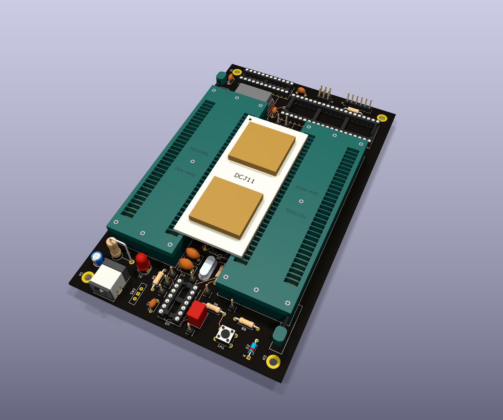

# DCJ11 test rig

**A KiCad project designed from scratch with AI assistance.**
The human gives instructions and reviews the AI's work.
This covers the circuit, custom parts, models and docs.
An autorouter lays the tracks.

[AGENTS.md](AGENTS.md) holds our working rules. Copy and adapt them for
your projects.

The rig checks DEC DCJ11-AE CPUs through their built-in ODT console.
It uses a 4 MHz crystal, a DC319A DLART and two ZIF sockets.
The [GAL source and programming file](logic/gal/README.md) are included.

**ODT works on hardware.** CPU register writes read back correctly in the
[first console check](docs/assembly.md). This is a quick check, not a full CPU test.

[Open in KiCad 10](kicad/rig/rig.kicad_pro) ·
[Build guide](docs/build.md) ·
[PCB files](dcjrig-jlcpcb-3ac8660.zip) ·
[Sources and credits](THIRD_PARTY.md)

Inspired by Peter Schranz's
[Modular DCJ11 SBC](https://www.5volts.ch/pages/dcj11sbc/).
