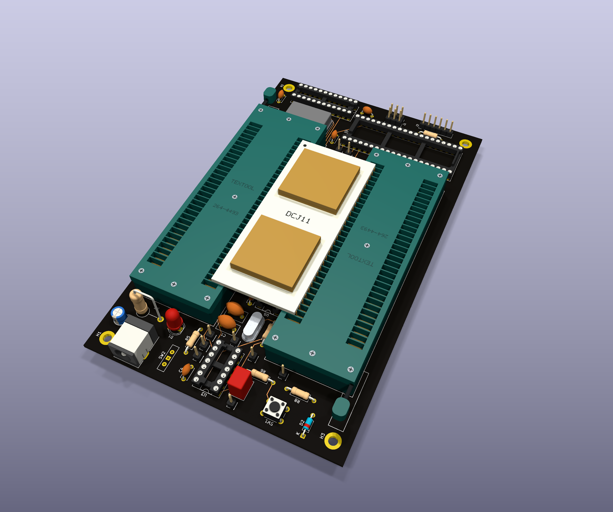

# DCJ11 test rig

**A small KiCad project designed from scratch with AI assistance.**
The human gives instructions, AI does the work, and the human checks it.
That covers the circuit, custom parts, 3D models and documentation.
An autorouter lays the tracks.

[AGENTS.md](AGENTS.md) holds our working rules. Copy and adapt them for
your own projects.

The rig uses a DEC DCJ11-AE's built-in ODT console for a quick CPU check.
It uses a 4 MHz crystal, a DC319A DLART and two ZIF sockets.
The [GAL source and programming file](logic/gal/README.md) are included.
The board and GAL logic have not been tested on real hardware.

[Open in KiCad 10](kicad/rig/rig.kicad_pro) ·
[Build guide](docs/build.md) ·
[PCB files](dcjrig-jlcpcb-3ac8660.zip) ·
[Sources and credits](THIRD_PARTY.md)

Inspired by Peter Schranz's
[Modular DCJ11 SBC](https://www.5volts.ch/pages/dcj11sbc/).
