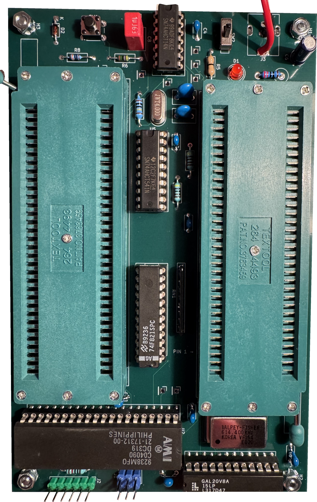
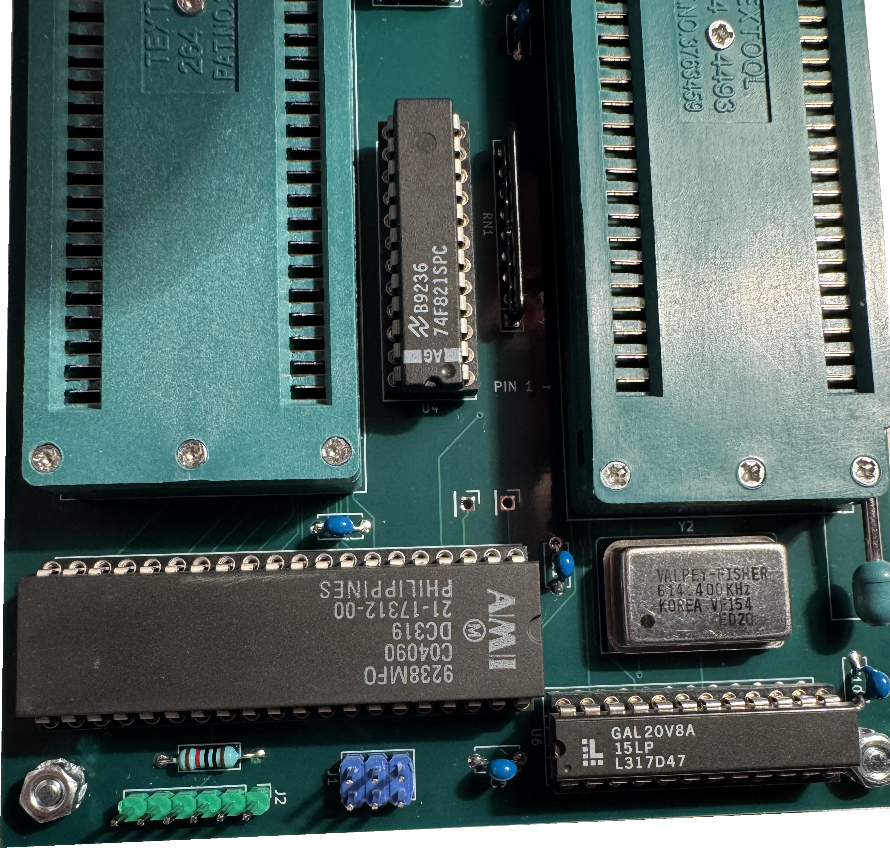

# Assembled board

The board is assembled but has not been powered on. The CPU is not fitted.
The backgrounds were removed with a mask. Retained board pixels are unchanged.

The power jack connects by wires because its footprint did not fit the part.
See the [build guide](build.md) for connections and the
[component checks](../tests/components/README.md) for test results and limits.
